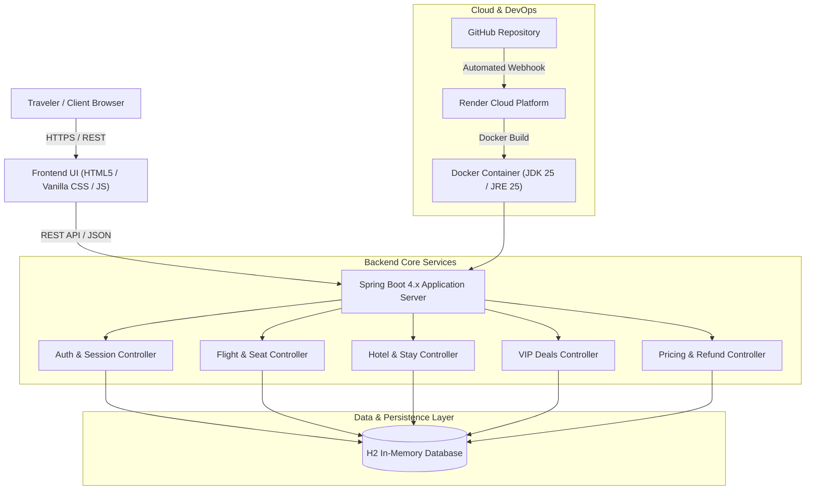
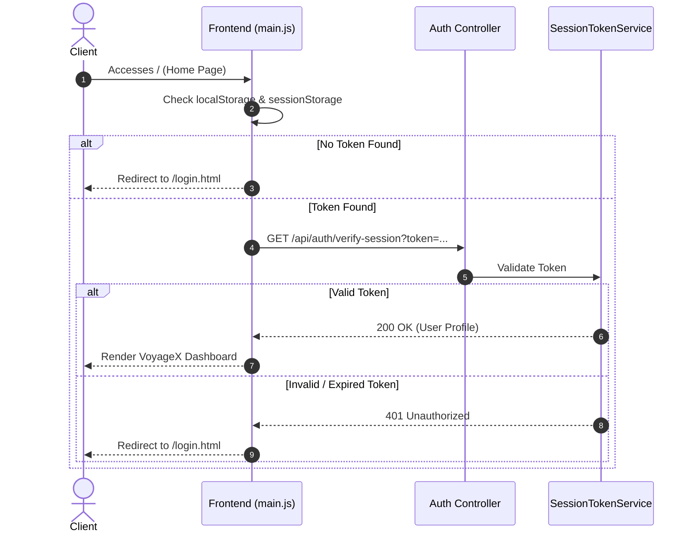

# Project Report: VoyageX — Modern Travel & Hospitality Platform

---

## 1. Executive Summary

**VoyageX** is an end-to-end full-stack travel booking and hospitality management web application developed using **Java 25**, **Spring Boot 4.x**, **Spring Data JPA**, and an interactive **HTML5/CSS3/JavaScript (ES6+)** frontend. The platform simulates an enterprise airline and hotel booking service with dynamic flight search, live flight status tracking, interactive aircraft seat map selection, luxury hotel reservation, VIP package deals, cancellation/refund policy calculations, and community reviews.

The system incorporates a security-first architecture featuring an initial **Authentication Gateway** (auth guard) that verifies user sessions before granting dashboard access. The application is containerized with a production multi-stage **Dockerfile** and configured for continuous integration and automated deployment on **Render** via **GitHub**.

---

## 2. Project Objectives & Scope

### 2.1 Objectives
1. **Seamless Travel Experience:** Unify flight discovery, seat selection, hotel reservations, and VIP luxury travel packages into a cohesive single-page-like experience.
2. **Robust Security & Session Control:** Enforce authentication before site entry with session token persistence, password hashing, and server-side token revocation.
3. **Interactive & Responsive UI:** Deliver a modern dark/light luxury theme using glassmorphism, micro-animations, real-time input validation, and mobile responsiveness without heavyweight frontend frameworks.
4. **Cloud-Native Deployment:** Provide containerized deployment via Docker and automated CI/CD from GitHub to cloud infrastructure (Render).

### 2.2 System Scope
- **User Roles:** Registered travelers and authenticated guests.
- **Flight Services:** Domestic/international flight searches, dynamic fare calculations, price freezing, seat reservation, and live flight tracking.
- **Lodging Services:** Hotel search, amenity filtering, room tier selection, and instant booking confirmation.
- **Customer Care & Flexibility:** Automated cancellation policies with instant refund quotes.

---

## 3. System Architecture & Tech Stack



### 3.1 Technology Stack Details

| Component | Technology | Rationale |
| :--- | :--- | :--- |
| **Language** | Java 25 (LTS) | Modern Java language features, virtual threads support, strong typing, and performance. |
| **Framework** | Spring Boot 4.x | Rapid API development, embedded Tomcat, automated configuration, and production readiness. |
| **Data Layer** | Spring Data JPA / Hibernate | Object-Relational Mapping (ORM) and declarative repository querying. |
| **Database** | H2 Database (In-Memory) | Embedded, zero-configuration database ideal for development, testing, and continuous demonstrations. |
| **Frontend** | HTML5, CSS3, Vanilla JS (ES6+) | Framework-less design for maximum performance, minimal bundle weight, and rapid rendering without Node build steps. |
| **Containerization** | Docker (Multi-stage) | Builds with `eclipse-temurin:25-jdk` and runs on lightweight `eclipse-temurin:25-jre` runtime. |
| **Hosting & CI/CD** | Render + GitHub | Continuous deployment triggered on every `git push origin main`. |

---

## 4. Key Functional Modules

### 4.1 Authentication & Security Gateway
- **Auth Guard Flow:** The application enforces a mandatory authentication gateway. Unauthenticated requests to the root index are automatically intercepted and redirected to `/login.html`.
- **Session Token Service:** Employs cryptographically secure token generation (`SessionTokenService`) mapped to user accounts with timed validity.
- **Account Recovery:** Multi-step password reset workflow validating identity before accepting credential updates.



### 4.2 Flight Search & Reservation System
- **Criteria-based Querying:** Filter flights by origin airport, destination, departure/return dates, cabin class (Economy, Premium Economy, Business, First), and passenger capacity.
- **Dynamic Pricing Engine:** Calculates realistic ticket pricing with taxes, fuel surcharges, and cabin multipliers.
- **Interactive Seat Map:** Visualizes an aircraft layout with live seat status (free, selected, reserved).
- **Price Freeze:** Enables users to lock current fares for 48 hours for a nominal holding fee.

### 4.3 Lodging & Stays Management
- **Destination Hotel Finder:** Queries accommodations by city, star ratings, and amenities (Wi-Fi, Pool, Fitness Center, Dining).
- **Room Selection:** Real-time room tier breakdown (Deluxe King, Executive Suite, Ocean View) with instant booking confirmation numbers.

### 4.4 VIP Deals & Curated Travel
- **Exclusive Travel Bundles:** Pre-configured holiday packages with discounts across Tropical, European, Urban, and Mountain categories.
- **Member-Only Perks:** Highlights complimentary breakfast, airport chauffeur transfers, and flexible cancellations.

### 4.5 Cancellation & Automated Refund Engine
- **Policy Calculator:** Computes refund eligibility based on ticket class and cancellation lead time prior to departure.
- **Instant Processing:** Issues confirmation codes and refund transaction receipts.

---

## 5. Database Schema & Data Models

The persistence layer uses JPA entities initialized with structured seed data:

| Entity Name | Description | Key Attributes |
| :--- | :--- | :--- |
| `UserAccount` | Registered user credentials and profile | `id`, `name`, `email`, `passwordHash`, `role`, `createdAt` |
| `FlightOffer` | Scheduled flights and pricing options | `flightNumber`, `origin`, `destination`, `departureTime`, `basePrice`, `airline` |
| `Hotel` | Lodging properties and metadata | `id`, `name`, `city`, `rating`, `pricePerNight`, `amenities` |
| `HotelRoom` | Individual room tiers under a property | `id`, `hotelId`, `roomType`, `price`, `availableRooms` |
| `SeatInfo` | Seat layout and availability status | `seatNumber`, `seatClass`, `isOccupied`, `extraLegroom` |
| `VipDeal` | Curated discount packages | `id`, `title`, `destination`, `originalPrice`, `discountedPrice`, `category` |
| `TravelReview` | User ratings and destination reviews | `id`, `authorName`, `rating`, `comment`, `targetType`, `createdAt` |

---

## 6. REST API Specification

### Authentication Endpoints
- `POST /api/auth/login` — Authenticates credentials; returns user profile and session token.
- `POST /api/auth/register` — Creates user account with field validation.
- `GET /api/auth/verify-session?token={token}` — Validates session validity.
- `POST /api/auth/logout` — Revokes session server-side.
- `POST /api/auth/forgot-password` — Handles self-service password reset requests.

### Flight & Booking Endpoints
- `POST /api/flights/search` — Searches available flights matching criteria.
- `GET /api/flights/status/{flightNumber}` — Returns live status, gate, and departure tracking.
- `POST /api/bookings/flight` — Generates a confirmed booking PNR and record.
- `POST /api/pricing/freeze` — Locks a quoted fare for a selected timeframe.

### Lodging & VIP Endpoints
- `GET /api/hotels/recommendations` — Retrieves hotel properties based on user preferences.
- `POST /api/hotels/book` — Reserves rooms with confirmation receipts.
- `GET /api/vip-deals` — Delivers curated travel packages with active promotions.

### Cancellation Endpoints
- `POST /api/cancellations/quote` — Generates transparent refund quote.
- `POST /api/cancellations/confirm` — Completes booking cancellation.

---

## 7. Containerization & Cloud Deployment

### 7.1 Docker Multi-Stage Build
The application uses a two-stage Docker pipeline to maintain container security and minimize image footprint:

```dockerfile
# Stage 1: Build JAR using Maven and OpenJDK 25
FROM eclipse-temurin:25-jdk AS build
WORKDIR /app
COPY mvnw mvnw.cmd pom.xml ./
COPY .mvn .mvn
COPY src ./src
RUN ./mvnw clean package -DskipTests

# Stage 2: Minimal runtime image
FROM eclipse-temurin:25-jre
WORKDIR /app
RUN groupadd -r spring && useradd -r -g spring spring
USER spring:spring
COPY --from=build /app/target/*.jar app.jar
EXPOSE 8080
ENTRYPOINT ["java", "-jar", "app.jar"]
```

### 7.2 Cloud Deployment (Render)
- **Automatic CI/CD:** Connected to the GitHub repository `HarshithaR-cyber/voyagex-travelbooking` on branch `main`.
- **Dynamic Port Binding:** Supports `server.port=${PORT:8080}` to bind dynamically to cloud-assigned port variables.
- **Zero Downtime:** Automated rollouts on every `git push`.

---

## 8. Verification & Test Results

The platform underwent automated and integration verification:

| Test Case | Description | Result |
| :--- | :--- | :--- |
| **TC-01: Auth Guard Redirection** | Verify that unauthenticated visitors are redirected to `/login.html`. | **PASS** |
| **TC-02: User Registration** | Validates email syntax, mandatory fields, and duplicate prevention. | **PASS** |
| **TC-03: User Sign-In** | Authenticates valid credentials and issues valid session token. | **PASS** |
| **TC-04: Session Verification** | Checks `/api/auth/verify-session` against active tokens. | **PASS** |
| **TC-05: Flight Search API** | Filters flight offers by routes, class, and dates. | **PASS** |
| **TC-06: Interactive Seat Map** | Renders cabin seat grid with state selection. | **PASS** |
| **TC-07: VIP Deals Endpoint** | Serves category-filtered packages (Tropical, European, etc.). | **PASS** |
| **TC-08: Cloud Port Binding** | Binds to `PORT` environment variable when deployed on cloud containers. | **PASS** |

---

## 9. Conclusion & Future Roadmap

**VoyageX** demonstrates a modern, secure, and production-ready travel booking architecture. By combining a Java 25 / Spring Boot backend with a responsive, glassmorphic UI and cloud-native containerization, the project delivers a fast and reliable user experience.

### Potential Future Enhancements:
1. **Third-Party Payment Gateways:** Integration with Stripe or PayPal for real credit/debit card processing.
2. **External GDS / Airline APIs:** Connecting to live travel aggregators (Amadeus, Skyscanner API) for real-time global inventory.
3. **Persistent Cloud Database:** Migration from H2 in-memory to PostgreSQL on AWS RDS or Supabase for persistent multi-year records.
4. **Email / SMS Notifications:** Integration with SendGrid or Twilio for automated booking confirmation emails and boarding passes.
